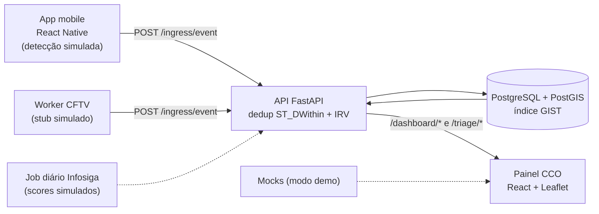

# ViaGuardian Intelligence Center

> Plataforma preditiva de segurança viária colaborativa para motociclistas — **protótipo acadêmico**.
>
> Submetido ao Prêmio Senatran 2026 — categoria Projeto Acadêmico (resultado ainda não divulgado).

**Demo:** <https://viaguardian-demo.vercel.app> (roda em **modo demo**, com dados mockados e sem backend) · Emulação do app: <https://viaguardian-demo.vercel.app/mobile>

---

## O problema

Motociclistas são o grupo mais vulnerável no trânsito urbano brasileiro. Buracos, óleo na pista, obstruções e sinalização apagada costumam ser tratados de forma reativa, dependendo de chamados manuais (ex.: 156), e ficam expostos por muito tempo antes de qualquer manutenção.

## A solução proposta

Um ecossistema de *crowdsensing* em quatro partes:

1. **App do motociclista** (React Native) que, no conceito, detecta anomalias na via com visão computacional no próprio aparelho e envia eventos georreferenciados anonimizados.
2. **API de ingestão** (FastAPI + PostGIS) que recebe os eventos, **deduplica espacialmente** ocorrências próximas e calcula um Índice de Risco Viário (IRV).
3. **Worker CFTV** que, no conceito, processaria câmeras públicas e usaria o mesmo contrato de ingestão.
4. **Painel do Centro de Controle Operacional (CCO)** com KPIs, mapa de calor e triagem (aprovar/rejeitar) dos incidentes.

> Este repositório é um **protótipo**: a parte geoespacial e o fluxo de ingestão/triagem são reais; a detecção por IA ainda é **simulada**. A tabela abaixo deixa isso explícito.

---

## Status real

| Componente | Status | Evidência |
|---|---|---|
| API de ingestão (`POST /ingress/event`, `POST /ingress/batch`) | ✅ Implementado | `backend/app/routers/ingress.py` |
| Deduplicação espacial com `ST_DWithin` (raio e janela configuráveis, padrão 12 m / 24 h) | ✅ Implementado | `backend/app/routers/ingress.py` (query de dedup), `backend/app/config.py` |
| Coluna `Geometry` (PostGIS) com índice GIST | ✅ Implementado | `backend/app/models.py` (`ix_incidents_location_gist`) |
| Cálculo do IRV `(Wa × D) + (Wh × S)` | ✅ Implementado | `backend/app/routers/ingress.py` (`calculate_irv`) |
| Endpoints do painel (métricas, heatmap, fila de triagem, aprovar/rejeitar) | ✅ Implementado | `backend/app/routers/dashboard.py` |
| Seed com coordenadas de vias de São Paulo | ✅ Implementado | `backend/scripts/seed_real_data.py` |
| Dashboard web com mapa Leaflet, gráficos e triagem | ✅ Implementado | `src/components/dashboard/HeatmapPanel.jsx`, `src/components/triage/TriageTable.jsx` |
| Modo demo (services retornam mocks sem chamar a API) | ✅ Implementado | `src/lib/demoMode.js`, `src/services/*.js`, `src/mocks/` |
| GPS e máquina de estados DRIVING/PARKED no app | ✅ Implementado | `mobile/src/hooks/useGpsWatcher.js`, `mobile/src/store/telemetryStore.js` |
| Anonimização do payload (hash SHA-256, `sanitizeBatch`) | ✅ Implementado | `mobile/src/utils/payloadBuilder.js` |
| Detecção de anomalias no app (YOLOv8/TFLite) | 🟡 **Simulado** — detecções fixas na tela; o módulo TFLite gera resultados com `Math.random()` e não está conectado a nenhuma tela | `mobile/src/screens/ActiveDrivingScreen.jsx`, `mobile/src/utils/tfliteProcessor.js` |
| Worker CFTV | 🟡 **Simulado** — inferência é um stub aleatório; sem câmera, gera frames sintéticos | `backend/worker_cftv.py` (`run_inference`, `run_simulation_loop`) |
| Sincronização Infosiga SP | 🟡 **Simulado** — o parse da resposta não está implementado; os scores históricos são sorteados | `backend/app/services/infosiga_sync.py` (`_apply_simulated_scores`) |
| Assistente de IA no painel | 🟡 **Simulado** — respostas pré-escritas por palavra-chave, sem modelo de linguagem | `src/components/ai/AiAgentWidget.jsx` (`KB`) |
| Login / autenticação | 🔴 **Não implementado** — tela visual, sem autenticação; a API não exige credenciais | `src/pages/LoginPage.jsx`, `backend/app/routers/` |
| Testes automatizados e CI | 🔴 **Não implementado** | — |

---

## Funcionalidades

**Painel CCO (web)**

- Rotas: `/` (dashboard), `/triagem`, `/cftv`, `/mobile` (emulação do app) e `/login` (protótipo visual) — `src/router/index.jsx`.
- KPIs, gráfico de tendência e rosca de severidade (Recharts).
- Mapa de calor e mini-mapa tático com Leaflet.
- Triagem: o operador aprova ou rejeita um incidente pendente (`PATCH /triage/incidents/{id}/status`).
- Quando a API não responde, os services usam os mocks como fallback (`src/services/dashboardService.js`, `src/services/triageService.js`).

**Backend**

- `GET /health`
- `POST /ingress/event` e `POST /ingress/batch`: validação Pydantic, dedup espacial e atualização do IRV.
- `GET /dashboard/metrics`, `GET /dashboard/heatmap`, `GET /triage/queue`, `PATCH /triage/incidents/{incident_id}/status`.
- Job diário às 03:00 (APScheduler) que atualiza os scores históricos (hoje, com valores simulados).

**App mobile (React Native)**

- Transição automática DRIVING/PARKED pela velocidade do GPS.
- Tela de condução com câmera e overlay de detecções (hoje, fixas).
- Tela de estacionado com resumo da sessão e envio dos eventos para a API.
- Alertas por vibração e voz (`mobile/src/utils/multimodalAlert.js`).

---

## Stack

Versões conforme os manifestos do repositório.

| Parte | Tecnologias |
|---|---|
| Web (`package.json`) | React ^19.2.6, Vite ^8.0.12, Tailwind CSS ^3.4.17, React Router ^7.16, TanStack Query ^5.100, Recharts ^3.8.1, Leaflet ^1.9.4, react-leaflet ^5.0.0, Axios ^1.16 |
| Backend (`backend/requirements.txt`) | Python 3.11 (`backend/Dockerfile`), FastAPI 0.115.6, Uvicorn 0.32.1, SQLAlchemy 2.0.36, GeoAlchemy2 0.15.2, asyncpg 0.30.0, Pydantic 2.10.3, pydantic-settings 2.6.1, httpx 0.28.1, APScheduler 3.10.4, opencv-python-headless 4.10.0.84 |
| Banco (`backend/docker-compose.yml`) | PostgreSQL + PostGIS (`postgis/postgis:15-3.3`) |
| Mobile (`mobile/package.json`) | React Native 0.75.3, react-native-vision-camera ^4.5.2, Zustand ^4.5.7, @react-native-community/geolocation ^3.4, react-native-tts ^4.1, react-native-haptic-feedback ^2.2, Axios ^1.7.2 |
| Deploy da demo | Vercel (`vercel.json`) |

---

## Arquitetura



Organização do backend: `main.py` (app, CORS, scheduler, `/health`) → `app/routers/` (ingress, dashboard) → `app/models.py` / `app/schemas.py` → `app/database.py` (engine assíncrona) → `app/services/infosiga_sync.py`.

---

## Como rodar

### Painel web

```bash
npm install
npm run dev            # http://localhost:5173
```

Sem backend, ative o modo demo (ver `.env.example`):

```bash
VITE_DEMO_MODE=true npm run dev
```

Com backend, o painel usa `VITE_API_BASE_URL` (padrão `http://localhost:8000`, em `src/lib/http.js`).

### Backend (API + PostGIS)

```bash
cd backend
docker-compose up --build
# API:     http://localhost:8000
# Swagger: http://localhost:8000/docs
```

As tabelas são criadas no startup da API. Para popular o banco com dados de exemplo:

```bash
docker-compose exec api python scripts/seed_real_data.py
```

### Worker CFTV (simulação)

```bash
cd backend
python worker_cftv.py --simulate
```

### App mobile

```bash
cd mobile
npm install
npm run android        # ou: npm run ios
```

> O app envia eventos para uma URL fixa em `mobile/src/screens/ParkedScreen.jsx` (`API_BASE_URL`); ajuste para o endereço da sua API antes de testar o envio.

---

## Demo

<https://viaguardian-demo.vercel.app> roda com `VITE_DEMO_MODE=true`: todos os números, incidentes e câmeras vêm de `src/mocks/` e **nenhuma chamada é feita à API**. A rota `/mobile` emula as telas do app em um frame de celular, incluindo uma cena de rua em SVG com 7 cenários rotativos (pedestre, buraco, quase-acidente etc.) e alertas por vibração e voz (Web Speech API) — tudo roteirizado, sem detecção real (`src/components/mobile/ActiveDrivingDemo.jsx`).

---

## Limitações conhecidas

- **IA de detecção não está implementada**: as detecções do app e do worker CFTV são simuladas; não há modelo treinado no repositório.
- Os scores históricos do IRV são sorteados (`infosiga_sync.py`), então o IRV não reflete dados reais de sinistros.
- **Sem autenticação** no painel e na API (`API_SECRET_KEY` existe em `backend/app/config.py`, mas não é usado).
- **Sem testes automatizados e sem CI.**
- Sem migrações versionadas: o schema é criado por `create_tables()` no startup (`backend/main.py`).
- O assistente de IA do painel usa respostas pré-escritas.
- A URL da API no app mobile está fixa no código.
- Credenciais do banco no `docker-compose.yml` são apenas de desenvolvimento local.

## Roadmap

- [ ] Rodar um modelo real de detecção (TFLite/TF.js) sobre frames de exemplo e conectar ao app.
- [ ] Testes do backend (pytest + PostGIS em contêiner) e pipeline de CI.
- [ ] Autenticação dos operadores do CCO (ou remover a tela de login).
- [ ] Parse real dos dados do Infosiga SP.
- [ ] URL da API configurável no app mobile.
- [ ] Integração SP156 para despacho de ordens de serviço.
- [ ] Alertas em tempo real para operadores (WebSocket/SSE).

---

## Privacidade (LGPD) — o que o código faz hoje

- O payload do app usa um `device_fingerprint` com hash SHA-256 e remove as bounding boxes antes do envio (`mobile/src/utils/payloadBuilder.js`).
- O worker CFTV gera o fingerprint da câmera por SHA-256 do ID (`backend/worker_cftv.py`).
- Nenhuma imagem é enviada à API: o contrato de ingestão (`backend/app/schemas.py`) só recebe metadados do evento.

## Autor

Christian Mendes — [@dev-christianmendes](https://github.com/dev-christianmendes)
